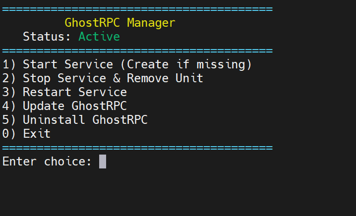

# 👻 GhostRPC Tunnel

<div dir="rtl" lang="fa">

**گوست‌آر‌پی‌سی (GhostRPC)** یک تونل و وب‌سرور لایه ۷ (L7) فوق‌سریع و ایمن است که تماماً با زبان قدرتمند **Rust** توسعه یافته است. این پروژه به صورت ویژه برای عبور از محدودیت‌های شدید شبکه‌ای و دور زدن فیلترینگ‌های پیشرفته طراحی شده است؛ با بهره‌گیری از مالتی‌پلکسینگ `HTTP/2`، مسیریابی بدون‌کپی (Zero-Copy) و سیستم دفاع فعال، سرور شما در برابر هرگونه اسکنر و سیستم‌های مانیتورینگ نامرئی خواهد ماند.

---

## 🚀 ویژگی‌های کلیدی

*   **وب‌سرور داخلی و Reverse Proxy:** بدون نیاز به برنامه‌های جداگانه مثل Nginx، می‌توانید مستقیماً فایل‌های استاتیک، سایت‌های `PHP/WordPress` (با FastCGI) و یا پنل‌های کاربری و سوکت‌های سیستم را پشت این تونل میزبانی کنید.
*   **مسیریابی پیشرفته و سریع (SNI Multiplexing & Web Server):** لایه‌های مسیریابی قدرتمندی در برنامه تعبیه شده‌اند که همگی با استفاده از تشخیص هوشمند SNI کار می‌کنند. به لطف این تکنولوژی، شما می‌توانید **چندین سرویس مختلف را روی یک پورت مشترک (مثلاً 443) اجرا کنید** و برنامه با خواندن نام دامنه (SNI)، ترافیک هر کاربر را به مقصد متفاوت و مشخصی هدایت می‌کند:
    *   مسیر `sni_proxy` (سمت سرور): خواندن پکت خام `ClientHello` و فوروارد مستقیم و بسیار سریع به مقصدهای مختلف بدون رمزگشایی (Zero-Copy).
    *   مسیر `port_mappings` (سمت کلاینت): هدایت ترافیک پورت‌های محلی کلاینت به مقصدهای ریموت در سرور از طریق بستر امن تونل.
    *   مسیر `web_server`: قابلیت وب‌سرور داخلی (مشابه Caddy) که از ۳ حالت مختلف (`reverse_proxy`, `static`, `fastcgi`) برای لایه ۷ پشتیبانی می‌کند.
*   **دفاع فعال (Camouflage):** در صورت مراجعه افراد متفرقه، سیستم‌های کاوشگر، یا ربات‌های سانسورچی، ترافیک آن‌ها به‌طور خودکار به یک سایت معتبر (مانند `ubuntu.com`) یا یک فایل نمایشیِ محلی هدایت می‌شود تا ماهیت واقعی سرور کاملاً پنهان بماند.
*   **مدیریت خودکار گواهینامه‌های SSL:** نیازی به دردسرهای تمدید SSL ندارید! با دادن توکن `Cloudflare` یا `Arvancloud`، سیستم به صورت کاملاً خودکار تمامی گواهی‌های دامنه‌ها را ایجاد و تمدید می‌کند و حتی می‌تواند آن‌ها را مستقیماً برای برنامه‌های دیگر شما (مثل پنل‌های X-UI و سنایی) کپی کند.
*   **مدیریت هوشمند منابع (Anti-Loop):** به لطف استفاده از تکنولوژی‌های Async زبان راست، اتصال‌های زنده (Keep-Alive) و سیستم‌های Backoff، سرور شما در برابر اختلالات شبکه مقاوم است و مصرف پردازنده و رم در پایین‌ترین سطح ممکن نگه داشته میشود.
*   **تغییرات بدون قطعی (Hot-Reload):** فایل تنظیمات را ویرایش کنید و با ذخیره کردن آن، تغییرات در کسری از ثانیه و بدون قطع شدن اتصال‌های فعالِ کاربران، در سیستم اعمال میشوند!
*   **تانل Reverse همزمان با Direct:** علاوه بر حالت Direct (کلاینت ایران ← سرور خارج)، سرور خارج می‌تواند خودش به کلاینت ایران وصل شود (Reverse). هر دو تانل **همزمان** برقرارند و در یک Pool مشترک قرار می‌گیرند؛ اگر یکی مسدود یا قطع شود، اتصال‌های جدید بدون وقفه از تانل دیگر عبور می‌کنند. ترافیک Reverse هم HTTP/2 معمولی است و مثل Direct از CDN (Cloudflare) عبور می‌کند.
*   **پشتیبانی از CDN آروان‌کلود و کلودفلر:** GhostRPC برای برقراری تونل از هر دو CDN آروان‌کلود (ArvanCloud) و کلودفلر (Cloudflare) پشتیبانی می‌کند؛ بنابراین استفاده از Cloudflare الزامی نیست. کلاینت CDN مورد استفاده را تشخیص می‌دهد و رنج‌های IP متناظر را برای اسکن و انتخاب IP سالم به کار می‌گیرد.
*   **کلاینت هوشمند (High Availability & Failover):**
    *   **اسکنر آی‌پی:** سمت کلاینت با اسکن دوره‌ای رنج‌های CDN مورد استفاده (Cloudflare یا ArvanCloud)، آی‌پی‌های سالم را شناسایی می‌کند تا اتصال به مسیر مستقیم بر اساس همان سرویس CDN انجام شود.
    *   **پایداری تضمین‌شده:** اگر ارتباط تونل با یکی از سرورها (SNI) قطع شود، کلاینت بلافاصله ترافیک `port_mappings` آن را از طریق تونلِ سرورهای دیگر (SNIهای جایگزین) به مقصد هدایت می‌کند تا هیچ قطعی احساس نشود.
    *   **قابلیت `share_sni`:** این پارامتر به شما کنترل کامل می‌دهد: اگر مقدار آن `0` باشد، ترافیک سایر تونل‌های قطع شده اجازه عبور از این تونل را ندارند. اما اگر عدد طبیعی (مثلاً `1` یا `2`) باشد، سایر ترافیک‌ها می‌توانند در صورت قطعی، از این تونل استفاده کنند؛ سیستم همیشه تونلی را برای جایگزینی انتخاب می‌کند که عدد `share_sni` آن کوچکتر (اولویت بالاتر) باشد.

---

## 🔀 پروتکل‌های تانل: HTTP/2 (gRPC) و WssMux

تانل (هم **Direct** و هم **Reverse**) روی دو پروتکل کار می‌کند و بین‌شان خودکار سوئیچ می‌کند:

*   `h2`: HTTP/2 با استریم‌های POST به سبک gRPC (پروتکل قبلی، بدون تغییر).
*   `wssmux`: WebSocket روی TLS (ارتقای HTTP/1.1) و روی آن یک multiplexer (`yamux`)؛ هر اتصال کاربر یک sub-stream مستقل است. ایدهٔ آن مثل `wssmux` در Backhaul است، ولی multiplexer آن `yamux` است نه `smux`؛ پس فقط بین دو سر GhostRPC کار می‌کند (با سرور Backhaul سازگار نیست).

```toml
# client.toml و/یا server.toml (اختیاری؛ پیش‌فرض ["h2", "wssmux"])
protocols = ["h2", "wssmux"]   # اولین = ترجیحی، بعدی‌ها = fallback خودکار
```

*   **تشخیص روی یک پورت:** هر دو پروتکل روی همان پورت و همان گواهی TLS کار می‌کنند. کلاینت `wssmux` در ALPN فقط `http/1.1` می‌فرستد و `h2` فقط `h2`؛ سرور از ALPN تشخیص می‌دهد.
*   **احراز هویت:** مثل `h2`: همان `hidden_path` و `secret` (هدر `x-tunnel-secret`). درخواست نامعتبر ۴۰۴ می‌گیرد.
*   **سوئیچ خودکار (Direct):** هر slot کانکشن به ترتیب اولویت وصل می‌شود. اگر پروتکلی وصل نشود، یا وصل شود ولی درخواست تانل را عبور ندهد (مثلاً CDN بدون gRPC)، آن پروتکل ۶۰ ثانیه «آخر صف» می‌رود و اتصال بعدی با پروتکل دیگر ساخته می‌شود. مسیریابی بین slotها همچنان بر اساس تأخیر و `location` است، چه slot روی h2 باشد چه wssmux.
*   **انتخاب مسیر Direct/Reverse:** کلاینت ابتدا Direct را ترجیح می‌دهد و اگر آماده نباشد به Reverse می‌رود. اگر هنوز هیچ مسیری آماده نباشد، سلامت مسیر هر ثانیه بررسی می‌شود تا پس از برقراری Reverse منتظر چرخهٔ کامل نماند. پس از انتخاب Reverse، بازگشت به Direct تنها پس از دو بررسی دوره‌ای متوالی که هر دو مسیر را آماده ببینند انجام می‌شود؛ اگر Reverse قطع شود و Direct آماده باشد، سوئیچ به Direct فوری است. این ماندگاری از نوسان مسیر بر اثر خطاهای گذرای اتصال جلوگیری می‌کند. پایش مسیرهای فعال هر یک دقیقه اجرا می‌شود و با `tunnel_health_check_interval_minutes` در `client.toml` قابل تنظیم است؛ مقدار کمتر از ۱ به ۱ دقیقه تبدیل می‌شود.
*   **سوئیچ خودکار (Reverse):** dialerهای سرور خارج پروتکل‌ها را به ترتیب اولویت امتحان می‌کنند؛ انتخاب Reverse در کلاینت بر اساس stream/sessionهای آماده انجام می‌شود، نه رقابت تأخیر Reverse با Direct برای تک‌تک کاربران.
*   **عبور از CDNهای Cloudflare و ArvanCloud:** GhostRPC می‌تواند تونل را از طریق هر یک از این دو CDN برقرار کند. WebSocket بدون روشن کردن gRPC هم از CDN عبور می‌کند؛ پس `wssmux` معمولاً fallback مناسبی وقتی gRPC خاموش است.
*   **رنج IPهای CDN:** رنج‌های Cloudflare در `ips/cloudflare_ip_ranges.txt` و رنج‌های ArvanCloud در `ips/arvancloud_ip_ranges.txt` نگهداری می‌شوند. هنگام استفاده از ArvanCloud، برنامه ابتدا فهرست رسمی `https://www.arvancloud.ir/en/ips.txt` را دریافت و فایل را به‌روزرسانی می‌کند؛ اگر دریافت ناموفق باشد از فایل cache معتبر استفاده می‌کند و در نبود cache معتبر، رنج‌های داخلی را در فایل می‌نویسد.
*   `protocols = ["h2"]` دقیقاً رفتار قبلی است. اگر `h2` را از فهرست سرور حذف کنید، سرور فقط wssmux می‌پذیرد.
*   سوئیچ فقط هنگام (باز)اتصال انجام می‌شود: یک session سالمِ wssmux تا قطع شدنش روی همان می‌ماند.

---

## 🔁 تانل Reverse (همزمان با Direct)

در حالت **Direct**، کلاینت (ایران) به سرور (خارج) وصل می‌شود. در حالت **Reverse** جهت برقراری اتصال برعکس است: سرور (خارج) به کلاینت (ایران) وصل می‌شود، اما مسیر داده همان است (کاربران به پورت‌های `port_mappings` کلاینت وصل می‌شوند و ترافیک از سرور خارج به مقصد می‌رسد). هر دو حالت **همزمان** فعال‌اند.

**طرز کار (سازگار با CDN):** سرور خارج چند درخواست HTTP/2 (gRPC) «آماده» روی کلاینت باز نگه می‌دارد. با ورود کاربر، کلاینت یکی از آن‌ها را برمی‌دارد و مقصد را روی آن می‌فرستد؛ سرور به مقصد وصل می‌شود و داده رد و بدل می‌شود. چون همه چیز درخواست‌های معمولی HTTPS/H2 است، می‌توانید دامنهٔ IP ایران را پشت Cloudflare بگذارید.

**سمت کلاینت (`client.toml`):**

```toml
[client]
secret = "my_secret_password"
hidden_path = "/api/v4/telemetry"
reverse_bind_addr = "0.0.0.0:2083"     # برای Cloudflare: 443 / 2053 / 2083 / 2087 / 2096 / 8443
reverse_tunnel_sni = ["*.example.com"]  # دامنه‌های Reverse: اشتراک پورت + گواهی Wildcard خودکار (ACME)
# cloudflare_api_token = "..."          # برای دریافت گواهی Wildcard (یا arvancloud_api_token)
```

**سمت سرور (`server.toml`):** `secret` و `hidden_path` از همان `[server]` گرفته می‌شوند و گواهی TLS مثل Direct همیشه اعتبارسنجی می‌شود.

```toml
[[server.reverse]]
sni = "respina.example.com:2083"          # دامنهٔ پروکسی‌شده در CF (SNI و Host)، اختیاراً با :پورت (پیش‌فرض 443)
# clean_ip = ["104.16.1.1", "104.17.2.2"]  # اختیاری: آی‌پی‌های تمیز CF یا دامنه؛ هر اتصال بین همه race می‌شود
# pool_size = 8                           # اختیاری (۸ اتصال × ۴ stream = ۳۲ stream آماده)
# location = "Germany"                    # اختیاری: با location، سرور برای مقصدهای همان لوکیشن به localhost وصل می‌شود (try_local) و قوانین share_sni اعمال می‌شود
```

**استفاده پشت Cloudflare:** رکورد دامنه (مثلاً `respina.example.com`) را با ابر نارنجی به IP ایران بزنید؛ در Cloudflare گزینهٔ **gRPC** (Network) را روشن کنید؛ پورت را از لیست پورت‌های HTTPS پشتیبانی‌شدهٔ Cloudflare انتخاب کنید؛ حالت SSL را روی **Full** (با گواهی خودامضا) یا **Full (strict)** (با گواهی معتبر در پوشهٔ `certs/` کلاینت، مثلاً با `acme_domains`) بگذارید.

**گواهی Wildcard در کلاینت:** مثل `tunnel_sni` در سرور، برای زون دامنه‌های `reverse_tunnel_sni` یک گواهی `zone + *.zone` با ACME (DNS-01) گرفته و خودکار تمدید می‌شود و بعد از صدور، Hot-Reload گواهی جدید را برمی‌دارد. فقط توکن `cloudflare_api_token` (یا `arvancloud_api_token`) در `[client]` لازم است. این برای حالت Full (strict) در Cloudflare کاربرد دارد.

**اشتراک یک پورت (مثلاً 443):** سرور خارج برای Reverse «خروجی» وصل می‌شود، پس با پورت listener سرور (Direct) تداخلی ندارد. روی کلاینت ایران اگر پورت `reverse_bind_addr` با یکی از پورت‌های `port_mappings`/`web_server` یکی باشد، فقط کافی است `reverse_tunnel_sni` را با دامنهٔ Reverse پر کنید؛ ترافیکی که SNI آن بخورد به Reverse و بقیه به مسیر عادی همان پورت می‌رود.

**نکات:**
*   هر تانل که تأخیر کمتری داشته باشد ترافیک جدید را می‌گیرد و دیگری آمادهٔ استفاده می‌ماند. با قطع هر کدام، اتصال‌های **جدید** بلافاصله از دیگری رد می‌شوند. اتصال‌هایی که همان لحظه روی تانلِ قطع‌شده در حال انتقال بودند ناگزیر قطع می‌شوند.
*   فقط نام‌های `clean_ip`، `reverse_bind_addr` و `reverse_tunnel_sni` معتبرند؛ نام‌های قدیمی `connect`، `reverse_bind` و `reverse_sni` حذف شده‌اند و دیگر شناخته نمی‌شوند (نادیده گرفته می‌شوند، پس در کانفیگ‌های قدیمی حتماً نام‌ها را عوض کنید).
*   ALPN در Reverse دقیقاً مثل Direct است: سمتِ پذیرنده `h2` و `http/1.1` (به همین ترتیب) و سمتِ اتصال‌دهنده فقط `h2`.
*   `secret` و `hidden_path` باید در هر دو سمت یکسان باشند. اگر `reverse_bind_addr`/`reverse_tunnel_sni` یا `[[server.reverse]]` تنظیم نشود، Reverse غیرفعال است و رفتار برنامه مثل قبل است.
*   `location` برای Reverse اختیاری است. تانل **بدون** location فقط «فورواردر» است: برای همهٔ مقصدها قابل استفاده است ولی پشت تانل لوکیشن خودِ مقصد قرار می‌گیرد و سرور همیشه مستقیم به هاست مقصد وصل می‌شود (`try_local = false`). تانل **با** location برای مقصدهای همان لوکیشن به localhost سرور وصل می‌شود (`try_local = true`) و برای لوکیشن‌های دیگر فقط اگر `share_sni` آن‌ها ۱ باشد، به‌عنوان پشتیبان و مستقیم به مقصد وصل می‌شود. سقف streamهای آماده در کلاینت خودکار از `pool_size_per_node` (پیش‌فرض ۸) محاسبه می‌شود.
*   اتصال با گواهی خودامضا بدون CDN پشتیبانی نمی‌شود؛ گواهی معتبر (مثلاً ACME داخلی در `certs/`) لازم است.
*   Hot-Reload پشتیبانی می‌شود.

---

## 📦 راهنمای نصب و راه‌اندازی

برای راه‌اندازی سریع پروژه و ساخت سرویس آن در لینوکس، تنها کافیست دستورات زیر را وارد کنید:

```bash
curl -sSL https://raw.githubusercontent.com/ArashAfkandeh/GhostRPC/main/install.sh | sudo bash
```

اسکریپت نصب تمامی کارها از جمله استخراج فایل‌ها و ایجاد منوی مدیریت ابزار را به صورت اتوماتیک انجام می‌دهد. پس از پایان نصب، می‌توانید از هر کجای سرور با اجرای دستور زیر، سرویس خود را مدیریت کنید:

```bash
ghostrpc
```
با استفاده از این منوی جذاب و گرافیکی (CLI) می‌توانید وضعیت سرویس را مانیتور کنید، تونل را استارت، استاپ، ری‌استارت، آپدیت و یا حتی به طور کامل از سرور حذف (Uninstall) کنید!

<p align="center">
  
</p>

---

## 🛠️ تنظیمات

تنظیمات برنامه در دو فایل `/root/GhostRPC/server.toml` (برای سرور خارج) و `/root/GhostRPC/client.toml` (برای سرور ایران) قرار دارند. نمونه‌های قرار داده شده به صورت کاملاً ساده و گویا طراحی شده‌اند و شما را از هرگونه پیچیدگی بی‌نیاز می‌کنند. 

> 💡 **نکته بسیار مهم (ویژگی Hot-Reload):**
> سیستم هوشمند GhostRPC به لحظه تغییرات فایل‌های کانفیگ (`*.toml`) را مانیتور می‌کند. این یعنی **هیچ نیازی نیست** که قبل از تنظیم کانفیگ‌ها، سرویس را متوقف کنید!
> کافیست در منوی `ghostrpc` سرویس را `Start` کنید و سپس با خیال راحت فایل کانفیگ خود را ویرایش کنید؛ تغییرات بلافاصله و بدون ری‌استارت شدن برنامه یا قطعی کاربران، اعمال خواهند شد.

</div>
